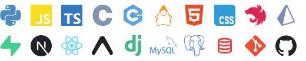

# Olá,eu sou Davi!👋

Sou estudante de Ciência da Computação na UFERSA e técnico em Desenvolvimento de Sistemas e mebro da equipe PegAzuls AeroDesign. Iniciante e amante da tecnologia e programação, busco aprendizagem e desenvolvimento na área.

